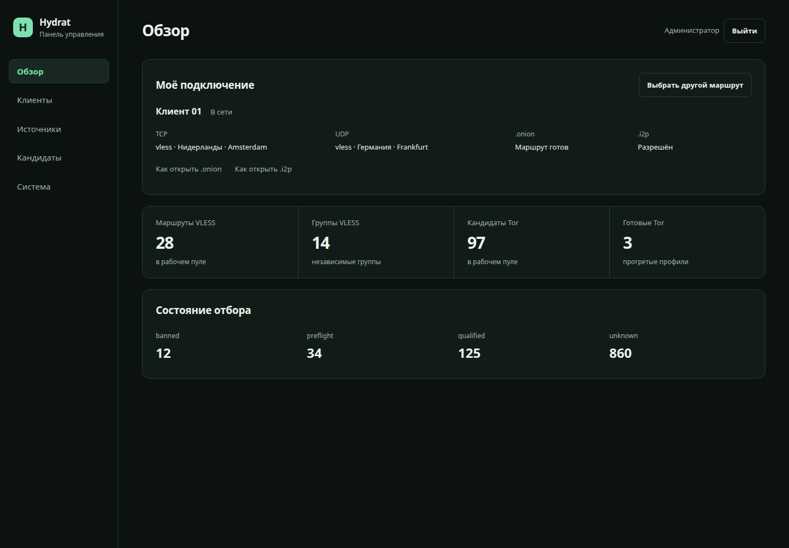
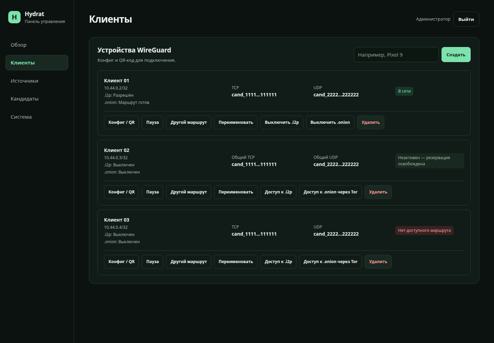
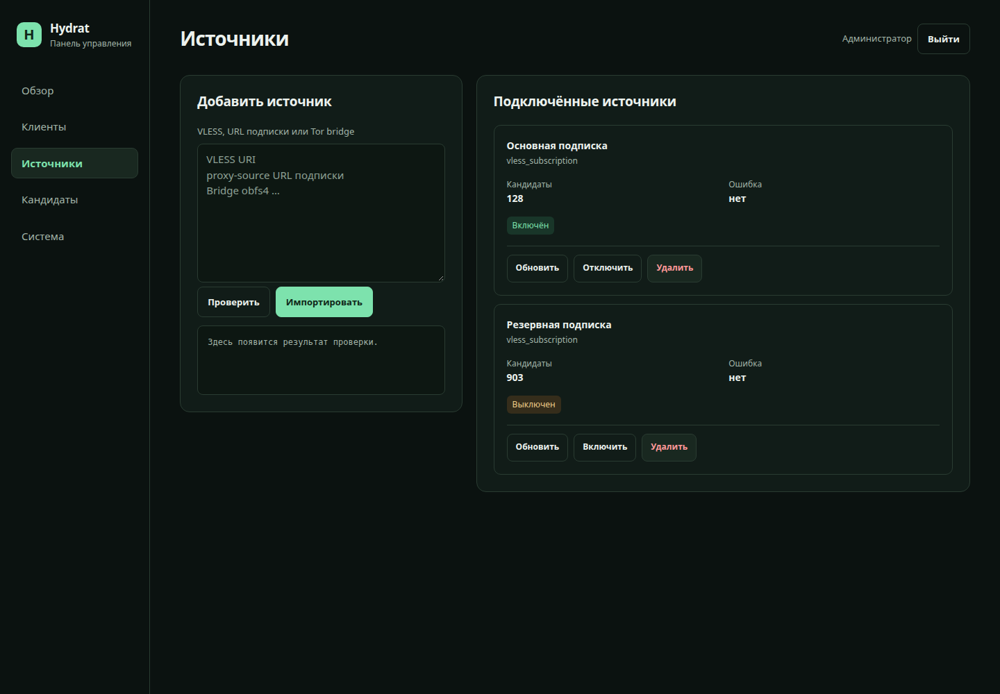
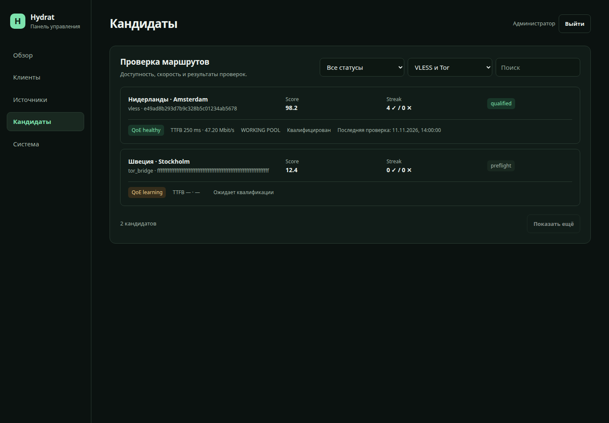
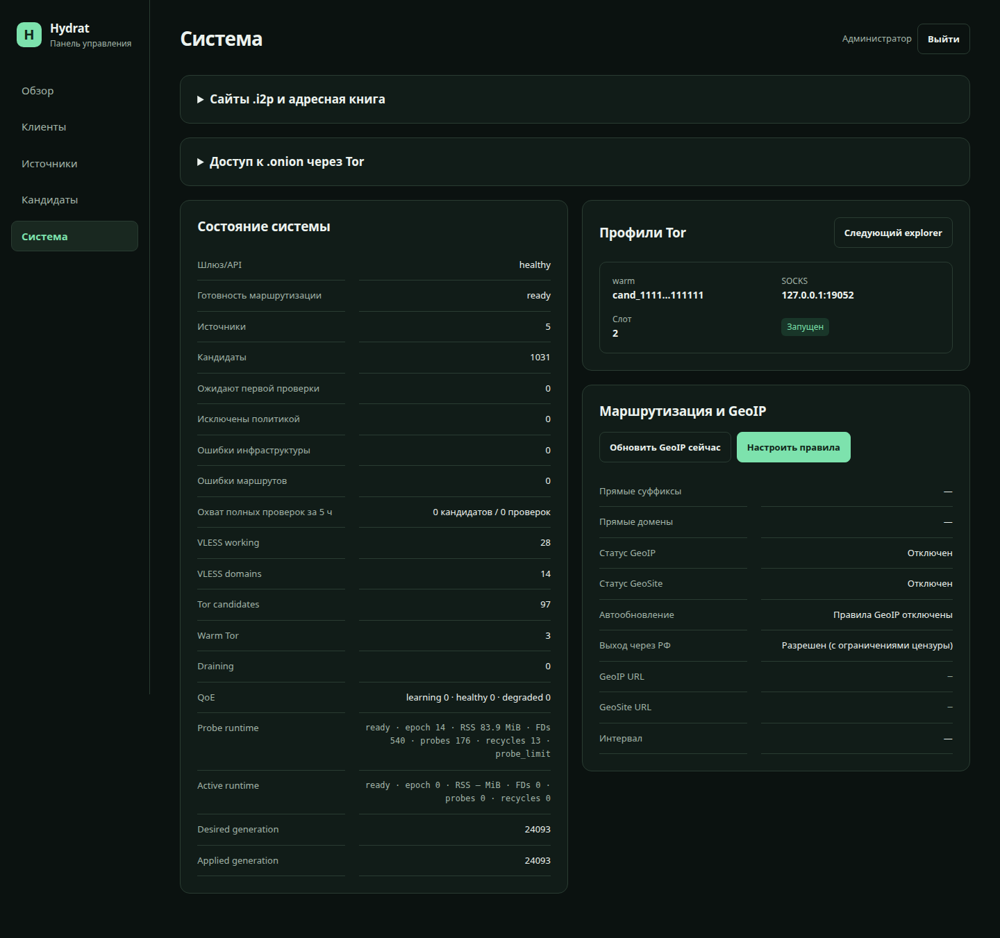
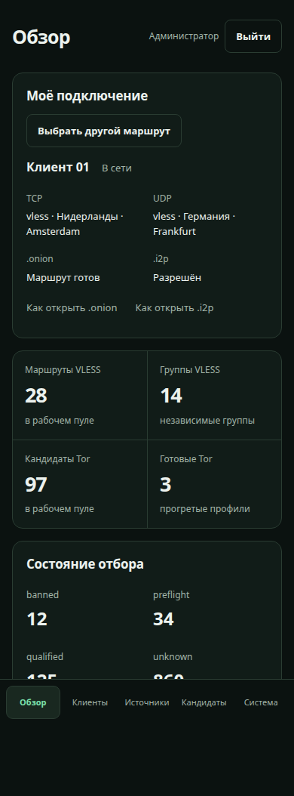

<p align="center">
  <strong>Русский</strong> · <a href="docs/en/README.md">English</a> · <a href="docs/zh-CN/README.md">简体中文</a>
</p>

<p align="center">
  
</p>
<p align="center">
  <a href="https://github.com/only-hydrat/hydrat/actions/workflows/ci.yml"></a>
  <a href="https://github.com/only-hydrat/hydrat/releases"></a>
  <a href="LICENSE"></a>
</p>

# Hydrat

**Один WireGuard-конфиг на устройстве, выбор маршрутов — на вашем сервере.**

Hydrat — VPN-шлюз для самостоятельного размещения. Вы добавляете VLESS-подписки и Tor-мосты, а шлюз проверяет их, назначает маршруты клиентам и выбирает замену при сбое. На телефоне, компьютере или роутере достаточно обычного клиента WireGuard.

Проект не предоставляет VPN-серверы или подписки: нужен свой Linux-сервер и источники маршрутов.

<p align="center">
  <a href="#возможности">Возможности</a> · <a href="#быстрый-запуск">Установка</a> · <a href="#настройка">Настройка</a> · <a href="#интерфейс">Скриншоты</a> · <a href="#документация">Документация</a>
</p>

## Возможности

- **Автоматический выбор и замена маршрутов.** Hydrat проверяет доступность узлов, задержку, скорость и работу сервисов со стороны шлюза. Поддерживает резерв и учитывает общие серверы у разных конфигов, чтобы не считать их независимыми альтернативами.
- **VLESS и Tor в одном пуле.** Обычно для TCP выбирается VLESS; прогретые Tor-профили могут служить резервом. UDP проверяется отдельно и передаётся только через подходящий VLESS-маршрут.
- **Проверки без перезапуска клиентского Xray.** Фоновые тесты работают в отдельных процессах. Сбой сервиса сравнивается с результатом через другой маршрут, а смена маршрута требует подтверждения, чтобы избежать лишних пересадок.
- **Управление устройствами в браузере.** Создание WireGuard-конфигов и QR-кодов, статус клиентов, назначенные маршруты, подписки и результаты проверок — в одной панели, доступной и с телефона.
- **Прямые и проксируемые маршруты.** Правила по доменам, GeoIP и GeoSite позволяют выбирать, какой трафик идёт напрямую. При отсутствии рабочего прокси трафик, предназначенный для него, блокируется, а не уходит напрямую.
- **Сайты .onion через VPN.** Доступ включается отдельно для каждого клиента. Hydrat проверяет Tor-профили для onion-сайтов и выбирает основной и резервный маршруты; инструкции для браузеров есть в панели.
- **Необязательный доступ к I2P.** Отдельная служба без ретрансляции чужого трафика, сон после простоя и ручной прогрев. Адресная книга содержит встроенные имена и поддерживает добавление сайтов, импорт и подписки `hosts.txt`.

## Быстрый запуск

Нужны Linux, Docker Engine с Compose v2, доступ к `/dev/net/tun` и открытый UDP-порт `51820`. Сервер должен быть доступен вашим устройствам по WireGuard. Готовые образы публикуются для **amd64 и arm64**; собирать проект на VPS не требуется. Расход памяти и CPU зависит от размера пула, числа клиентов и включённых Tor/I2P-профилей.

### 1. Скачайте проект

```sh
git clone https://github.com/only-hydrat/hydrat.git
cd hydrat
cp .env.example .env
```

### 2. Заполните `.env`

Укажите публичный IP или домен сервера и придумайте пароль администратора:

```dotenv
WIREGUARD_ENDPOINT=203.0.113.10:51820
HYDRAT_ADMIN_PASSWORD=replace-with-a-long-random-password
PORTAL_BIND_ADDRESS=127.0.0.1
PORTAL_PORT=8088
```

Если меняете внешний UDP-порт, задайте его и в `WIREGUARD_PORT`, и в `WIREGUARD_ENDPOINT`. Если подписка требует Happ HWID, заполните `HYDRAT_HWID`.

### 3. Запустите сервис

```sh
docker compose up -d
```

Compose загрузит `ghcr.io/only-hydrat/hydrat:1.2.0`. Другую версию можно выбрать через `HYDRAT_IMAGE` в `.env`.

### 4. Откройте панель

Для первого входа выполните **на своём компьютере**, подставив пользователя и адрес сервера:

```sh
ssh -N -L 8088:127.0.0.1:8088 user@203.0.113.10
```

Если SSH работает на другом порту, добавьте `-p PORT`. Оставьте туннель открытым и перейдите на [http://127.0.0.1:8088/](http://127.0.0.1:8088/). Войдите с паролем из `.env`.

Панель по умолчанию доступна на хосте только через localhost. Для внешнего доступа используйте SSH-туннель, сам VPN или HTTPS reverse proxy. Не открывайте HTTP-порт `8088` всему интернету.

### 5. Добавьте источник и устройство

В **«Источниках»** импортируйте подписку и дождитесь появления проверенных маршрутов. В **«Клиентах»** создайте устройство, скачайте конфиг или отсканируйте QR-код приложением WireGuard.

После подключения панель доступна внутри VPN по адресу [http://10.44.0.1/](http://10.44.0.1/).

## Настройка

Основные параметры находятся в [config/config.yml](config/config.yml), переменные запуска — в [.env.example](.env.example). Правила прямой маршрутизации также доступны в панели. По умолчанию среди прямых направлений есть `.ru`, `.su` и `.рф`; проверьте правила под свои задачи. Адреса проверяемых сервисов и собственные проверки задаются в `probes.gate_endpoints` и `probes.custom_gates`.

**.onion:** включите доступ у нужного клиента и откройте инструкцию в разделе «Система». [Руководство по Tor](docs/onion.md).

**I2P:** запустите дополнительную службу, затем разрешите доступ клиенту в панели:

```sh
docker compose -f docker-compose.yml -f docker-compose.i2p.yml up -d
```

При следующих обновлениях используйте ту же пару Compose-файлов. В «Системе» доступны адресная книга, подписки, статус и прогрев. [Руководство по I2P](docs/i2p.md).

## Что важно учитывать

- **WireGuard должен доходить до шлюза.** Hydrat не маскирует этот участок соединения. Если провайдер блокирует WireGuard или IP сервера, смена выходного прокси не поможет.
- **Переключение сохраняет туннель, но не каждую сессию.** При отказе маршрута или смене выходного IP приложениям может потребоваться переподключить TCP/QUIC-соединения. TCP и UDP могут использовать разные выходы.
- **Проверки выполняются со шлюза.** Они не измеряют качество сети между телефоном и сервером и не гарантируют доступность каждого сайта.
- **Tor и I2P по умолчанию выключены.** Для их сайтов нужен DNS шлюза; браузерный DNS через HTTPS может его обходить. Первое соединение при прогреве или смене профиля может занять время. Обычный браузер сохраняет cookies и отпечаток, а отсутствие ретрансляции не скрывает использование Tor/I2P от сети.

## Обновление и диагностика

Перед обновлением сохраните `.env`, свою конфигурацию и данные. Порядок согласованного резервного копирования SQLite и ключей описан в [руководстве по эксплуатации](docs/operations.md).

```sh
git pull --ff-only
docker compose pull
docker compose up -d
```

Если версия закреплена через `HYDRAT_IMAGE` или `HYDRAT_I2P_IMAGE`, обновите её в `.env`. Для установки с I2P добавляйте `-f docker-compose.yml -f docker-compose.i2p.yml` к командам Compose.

Проверить сервис и готовность маршрутов можно на сервере:

```sh
curl -i http://127.0.0.1:8088/api/health
curl -i http://127.0.0.1:8088/api/ready
```

`health` показывает доступность сервиса, `ready` — готовность маршрутов и резервов. Ответ `503` у `ready` может означать нехватку резерва, даже если текущие соединения работают. Для разбора причины смотрите панель и журналы:

```sh
sudo tail -n 100 "${DATA_DIR:-./data}/logs/gateway/gateway-current.log" \
  "${DATA_DIR:-./data}/logs/controller/controller-current.log"
```

## Интерфейс

Скриншоты используют демонстрационные имена клиентов, подписки и маршруты.

<p align="center">
  
</p>

<details>
<summary>Клиенты, источники, результаты проверок и мобильная панель</summary>

<p align="center"></p>
<p align="center"></p>
<p align="center"></p>
<p align="center"></p>
<p align="center"></p>

</details>

## Документация

- [Архитектура и выбор маршрутов](docs/architecture.md)
- [Эксплуатация, API, резервное копирование](docs/operations.md)
- [Доступ к .onion](docs/onion.md) · [Доступ к I2P](docs/i2p.md)
- [Безопасность и сообщение об уязвимости](SECURITY.md)
- [Релизы и история изменений](https://github.com/only-hydrat/hydrat/releases)

## Разработка

Для сборки из исходников выполните из корня проекта:

```sh
docker compose -f docker-compose.yml -f docker-compose.dev.yml up -d --build
```

Вариант сборки с I2P описан в [его руководстве](docs/i2p.md). Основные проверки:

```sh
go test ./...
node --test internal/portal/web_app_test.mjs
```

Нашли ошибку или хотите предложить изменение — [откройте issue](https://github.com/only-hydrat/hydrat/issues). Перед PR прочитайте [правила участия](CONTRIBUTING.md) и [кодекс поведения](CODE_OF_CONDUCT.md).

## Лицензия

[MIT](LICENSE).
