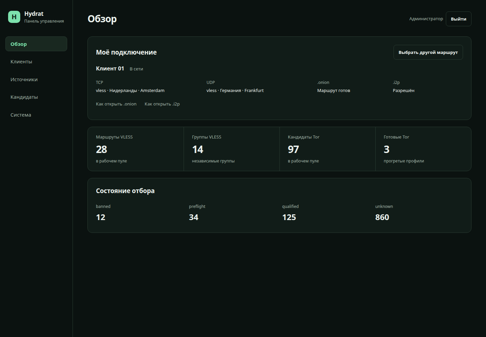
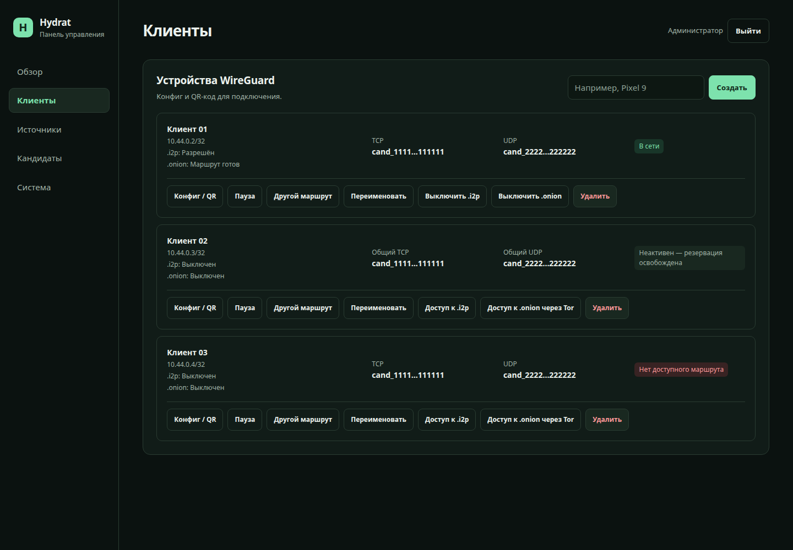
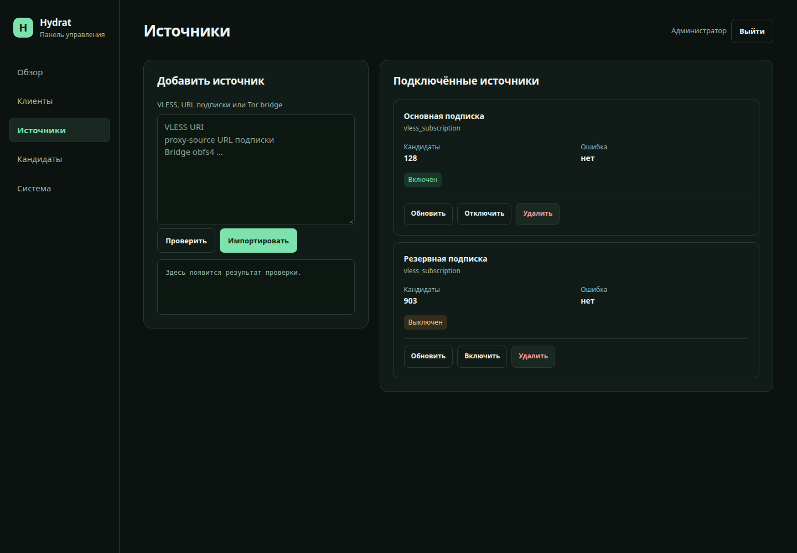
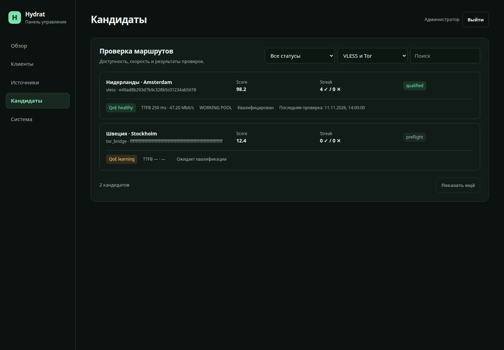
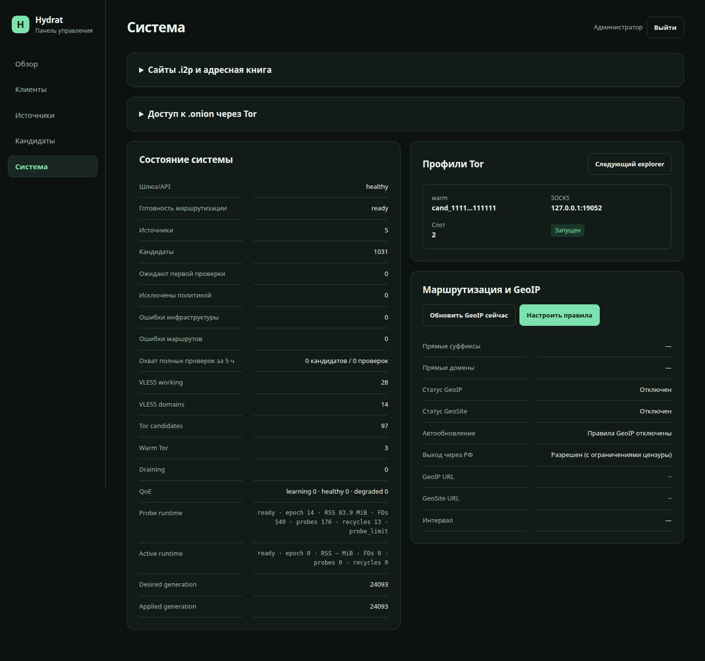
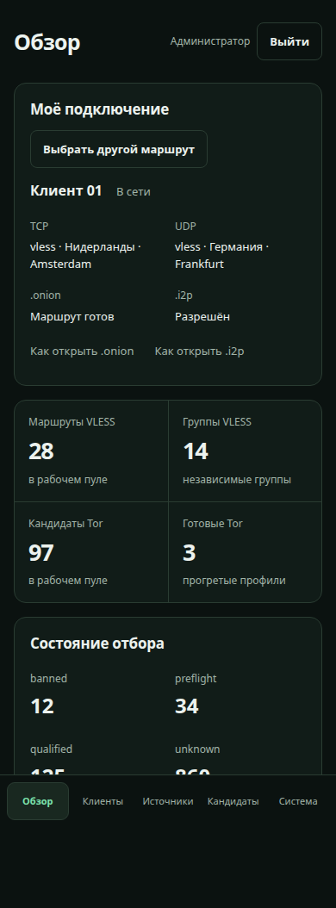

<p align="center">
  <a href="../../README.md">Русский</a> · <strong>English</strong> · <a href="../zh-CN/README.md">简体中文</a>
</p>

<p align="center">
  
</p>
<p align="center">
  <a href="https://github.com/only-hydrat/hydrat/actions/workflows/ci.yml"></a>
  <a href="https://github.com/only-hydrat/hydrat/releases"></a>
  <a href="../../LICENSE"></a>
</p>

# Hydrat

**One WireGuard config on your device. Route selection on your server.**

Hydrat is a self-hosted VPN gateway. Add VLESS subscriptions and Tor bridges; the gateway tests them, assigns routes to clients, and selects a replacement when a route fails. Your phone, computer, or router only needs a regular WireGuard client.

The project does not provide VPN servers or subscriptions. You need your own Linux server and route sources.

<p align="center">
  <a href="#features">Features</a> · <a href="#quick-start">Installation</a> · <a href="#configuration">Configuration</a> · <a href="#interface">Screenshots</a> · <a href="#documentation">Documentation</a>
</p>

## Features

- **Automatic route selection and failover.** Hydrat checks reachability, latency, throughput, and service access from the gateway. It maintains reserves and accounts for configurations that share a server instead of treating them as independent alternatives.
- **VLESS and Tor in one pool.** Normal TCP assignment prefers VLESS; warm Tor profiles can serve as reserves. UDP is tested separately and uses only a suitable VLESS route.
- **Probes without restarting client Xray.** Background tests run in separate processes. Service failures are compared with results through another route, and route changes require confirmation to avoid unnecessary switches.
- **Device management in your browser.** WireGuard configs and QR codes, client status, assigned routes, subscriptions, and probe results are available in one panel that also works on phones.
- **Direct and proxied routes.** Domain, GeoIP, and GeoSite rules control which traffic goes directly. If no proxy is available, traffic intended for a proxy is blocked rather than sent directly.
- **.onion sites over the VPN.** Enable access per client. Hydrat checks Tor profiles for onion access and selects a primary and reserve; browser setup instructions are included in the panel.
- **Optional I2P access.** A separate service with no third-party transit, idle sleep, and manual warmup. Its address book includes built-in names, manual entries, imports, and `hosts.txt` subscriptions.

## Quick start

You need Linux, Docker Engine with Compose v2, access to `/dev/net/tun`, and inbound UDP port `51820` open. Your devices must be able to reach the server over WireGuard. Prebuilt images are available for **amd64 and arm64**; no build is needed on the VPS. Memory and CPU use depend on pool size, client count, and enabled Tor/I2P profiles.

### 1. Download the project

```sh
git clone https://github.com/only-hydrat/hydrat.git
cd hydrat
cp .env.example .env
```

### 2. Set up `.env`

Enter your server's public IP or domain and choose an admin password:

```dotenv
WIREGUARD_ENDPOINT=203.0.113.10:51820
HYDRAT_ADMIN_PASSWORD=replace-with-a-long-random-password
PORTAL_BIND_ADDRESS=127.0.0.1
PORTAL_PORT=8088
```

If you change the external UDP port, set it in both `WIREGUARD_PORT` and `WIREGUARD_ENDPOINT`. Set `HYDRAT_HWID` if your subscription requires a Happ HWID.

### 3. Start the service

```sh
docker compose up -d
```

Compose downloads `ghcr.io/only-hydrat/hydrat:1.2.0`. To choose another version, set `HYDRAT_IMAGE` in `.env`.

### 4. Open the panel

For the first login, run this **on your own computer**, replacing the username and server address:

```sh
ssh -N -L 8088:127.0.0.1:8088 user@203.0.113.10
```

Add `-p PORT` if SSH uses a different port. Keep the tunnel open and visit [http://127.0.0.1:8088/](http://127.0.0.1:8088/). Log in with the password from `.env`.

By default, the host exposes the panel only on localhost. For remote access, use an SSH tunnel, the VPN itself, or an HTTPS reverse proxy. Do not expose HTTP port `8088` to the internet.

### 5. Add a source and a device

Import a subscription under **Sources** («Источники») and wait for qualified routes to appear. Under **Clients** («Клиенты»), create a device, then download its config or scan the QR code with WireGuard.

Once connected, the panel is available inside the VPN at [http://10.44.0.1/](http://10.44.0.1/).

## Configuration

Core settings are in [config/config.yml](../../config/config.yml); startup variables are listed in [.env.example](../../.env.example). Direct-routing rules are also available in the panel. Defaults include direct routes for `.ru`, `.su`, and `.рф`; review them for your setup. Service probe URLs and custom checks are configured in `probes.gate_endpoints` and `probes.custom_gates`.

**.onion:** enable access for the client and open the guide under **System** («Система»). [Tor guide](onion.md).

**I2P:** start the optional service, then allow client access in the panel:

```sh
docker compose -f docker-compose.yml -f docker-compose.i2p.yml up -d
```

Keep using this pair of Compose files for future updates. System settings include the address book, subscriptions, status, and warmup controls. [I2P guide](i2p.md).

## Things to know

- **WireGuard must reach the gateway.** Hydrat does not disguise this part of the connection. If your ISP blocks WireGuard or the server IP, changing the outbound proxy will not help.
- **Failover preserves the tunnel, not every session.** A failed route or changed exit IP may require applications to reconnect their TCP/QUIC sessions. TCP and UDP can use different exits.
- **Probes run from the gateway.** They do not measure the connection between your device and the server or guarantee access to every website.
- **Tor and I2P access are off by default.** Their sites require the gateway DNS; browser DNS over HTTPS can bypass it. The first connection during warmup or after a profile change may take time. A regular browser keeps cookies and its fingerprint, and disabling transit does not hide Tor/I2P use from the network.

## Updates and diagnostics

Back up `.env`, your configuration, and data before updating. See the [operations guide](operations.md) for a consistent backup of SQLite and its keys.

```sh
git pull --ff-only
docker compose pull
docker compose up -d
```

If `HYDRAT_IMAGE` or `HYDRAT_I2P_IMAGE` pins a version, update it in `.env`. For I2P installations, add `-f docker-compose.yml -f docker-compose.i2p.yml` to Compose commands.

Check service health and route readiness on the server:

```sh
curl -i http://127.0.0.1:8088/api/health
curl -i http://127.0.0.1:8088/api/ready
```

`health` reports service availability; `ready` reports route and reserve readiness. A `503` from `ready` can mean reserves are insufficient even while current connections work. Check the panel and logs for the reason:

```sh
sudo tail -n 100 "${DATA_DIR:-./data}/logs/gateway/gateway-current.log" \
  "${DATA_DIR:-./data}/logs/controller/controller-current.log"
```

## Interface

Screenshots use demonstration client names, subscriptions, and routes.

<p align="center">
  
</p>

<details>
<summary>Clients, sources, probe results, and mobile panel</summary>

<p align="center"></p>
<p align="center"></p>
<p align="center"></p>
<p align="center"></p>
<p align="center"></p>

</details>

## Documentation

- [Architecture and route selection](architecture.md)
- [Operations, API, and backups](operations.md)
- [.onion access](onion.md) · [I2P access](i2p.md)
- [Security and vulnerability reporting](SECURITY.md)
- [Releases and changelog](https://github.com/only-hydrat/hydrat/releases)

## Development

To build from source, run from the project root:

```sh
docker compose -f docker-compose.yml -f docker-compose.dev.yml up -d --build
```

The [I2P guide](i2p.md) covers building with I2P. Core checks:

```sh
go test ./...
node --test internal/portal/web_app_test.mjs
```

Found a bug or have a suggestion? [Open an issue](https://github.com/only-hydrat/hydrat/issues). Before submitting a PR, read the [contribution guide](CONTRIBUTING.md) and [code of conduct](CODE_OF_CONDUCT.md).

## License

[MIT](../../LICENSE).
