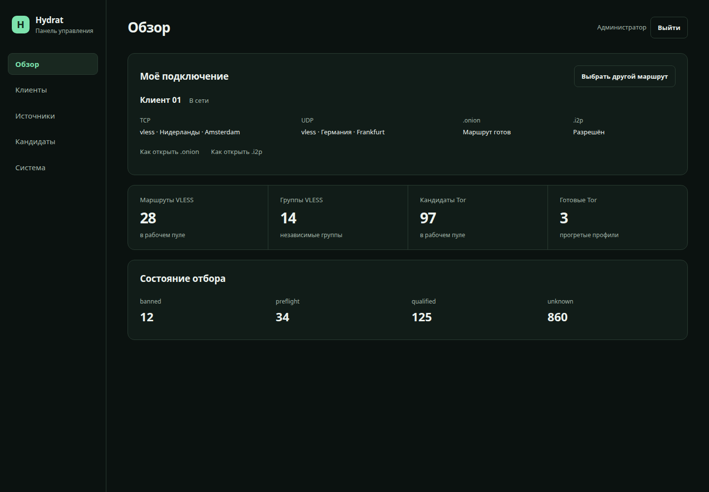
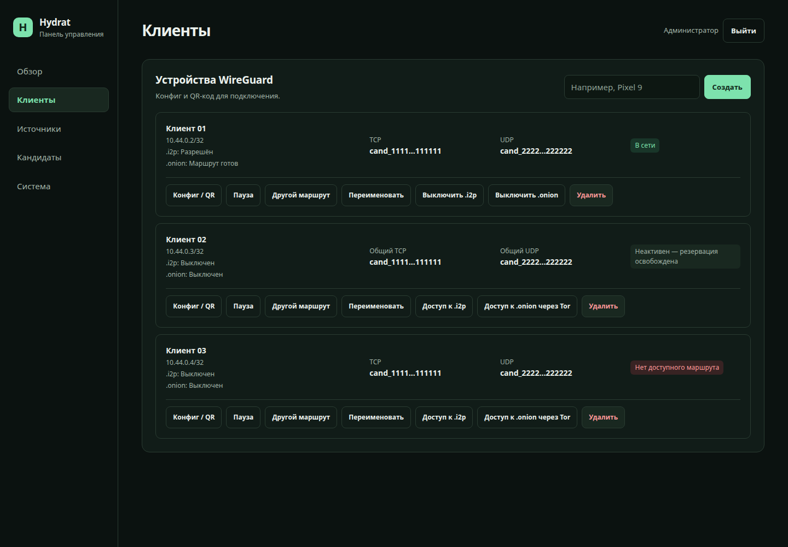
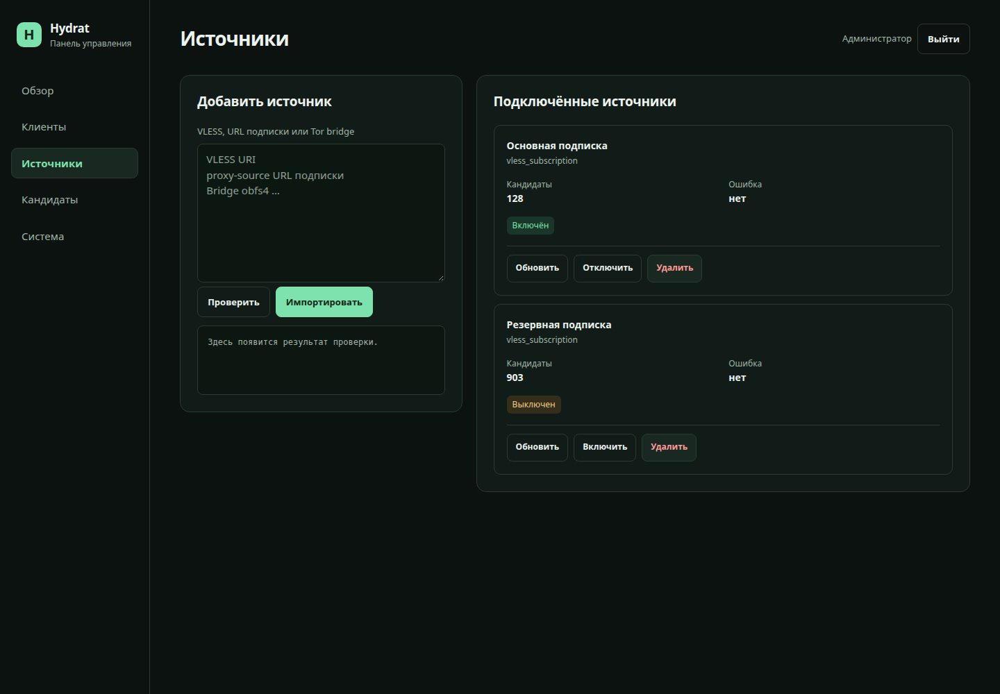
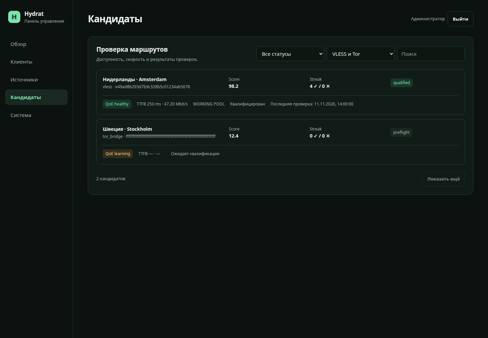
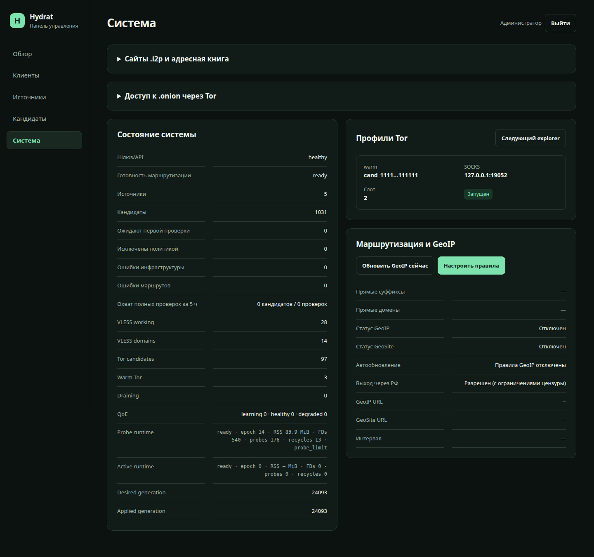
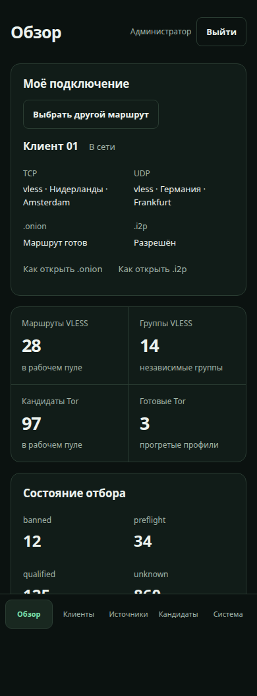

<p align="center">
  <a href="../../README.md">Русский</a> · <a href="../en/README.md">English</a> · <strong>简体中文</strong>
</p>

<p align="center">
  
</p>
<p align="center">
  <a href="https://github.com/only-hydrat/hydrat/actions/workflows/ci.yml"></a>
  <a href="https://github.com/only-hydrat/hydrat/releases/latest"></a>
  <a href="../../LICENSE"></a>
</p>

# Hydrat

Hydrat 会检测 VLESS 订阅和 Tor 网桥，自动选择路由，并在连接故障时切换到备用路由。

- **[Hydrat App](#应用)** 在 Android、Windows 或 Linux 设备上直接运行 VPN。
- **[Hydrat 网关](#快速开始)** 部署在自己的 Linux 服务器上。手机、电脑和路由器可通过标准 WireGuard 客户端连接。

<p align="center">
  <a href="#应用">应用</a> · <a href="#功能">网关功能</a> · <a href="#快速开始">安装网关</a> · <a href="#界面">截图</a> · <a href="#文档">文档</a>
</p>

## 应用

安装 Hydrat 后，在 **Подключения**（连接）中添加来源，然后点击 **Подключить**（连接）。每个 HTTPS 订阅都可以单独设置 HWID。

| 平台 | 下载 | 安装 |
| --- | --- | --- |
| Android 10+ · arm64 | [APK](https://github.com/only-hydrat/hydrat/releases/download/app-v0.1.3/Hydrat-android-arm64-0.1.3.apk) | [说明](../../app/android/README.md) |
| Windows 10/11 · x64 | [MSI](https://github.com/only-hydrat/hydrat/releases/download/app-v0.1.3/Hydrat-windows-x64-0.1.3.msi) · [ZIP](https://github.com/only-hydrat/hydrat/releases/download/app-v0.1.3/Hydrat-windows-x64-0.1.3.zip) | [说明](../../app/native/cmd/windows/README.md) |
| Debian 和 Ubuntu · amd64 | [DEB](https://github.com/only-hydrat/hydrat/releases/download/app-v0.1.3/hydrat-app_0.1.3_amd64.deb) | [说明](../../app/linux/README.md) |

在 Android 快捷设置或 Windows、Debian 系统托盘中即可切换 VPN。应用设置支持俄语、英语和简体中文。

打开 **设置 → 更新**检查版本。有新版时，Hydrat 会提供适用于当前平台的下载链接。下载后请手动安装。

[Hydrat App 0.1.3 和校验和](https://github.com/only-hydrat/hydrat/releases/tag/app-v0.1.3)

## 功能

- **自动选择路由与故障切换。** Hydrat 从网关检测节点连通性、延迟、吞吐量和服务可用性，维护备用路由，并识别共用服务器的配置，避免将它们当成独立的替代节点。
- **VLESS 与 Tor 共用候选池。** 常规 TCP 分配优先选择 VLESS；已预热的 Tor 配置可以作为备用。UDP 单独验证，仅使用适用的 VLESS 路由。
- **检测无需重启处理客户端流量的 Xray。** 后台测试在独立进程中运行。服务请求失败时，系统会与另一条路由的结果比较；切换需要经过确认，以减少不必要的变更。
- **在浏览器中管理设备。** 同一个面板提供 WireGuard 配置和二维码、客户端状态、已分配路由、订阅及测试结果，也支持手机访问。
- **直连与代理路由。** 通过域名、GeoIP 和 GeoSite 规则决定哪些流量直连。没有可用代理时，需要代理的流量会被阻断，不会自动改为直连。
- **通过 VPN 访问 .onion 网站。** 可为每个客户端单独启用。Hydrat 检测 Tor 配置的 onion 访问质量，选择主路由和备用路由；面板内提供浏览器设置指南。
- **可选 I2P 访问。** 独立服务不转发第三方中继流量，支持空闲休眠和手动预热。地址簿包含内置名称，并支持手动添加、导入和 `hosts.txt` 订阅。

## 快速开始

需要 Linux、Docker Engine 与 Compose v2、可用的 `/dev/net/tun`，以及开放的入站 UDP 端口 `51820`。设备必须能够通过 WireGuard 连接到服务器。项目提供 **amd64 和 arm64** 预构建镜像，无需在 VPS 上编译。内存和 CPU 用量取决于候选池规模、客户端数量及启用的 Tor/I2P 配置。

### 1. 下载项目

```sh
git clone https://github.com/only-hydrat/hydrat.git
cd hydrat
cp .env.example .env
```

### 2. 配置 `.env`

填写服务器公网 IP 或域名，并设置管理员密码：

```dotenv
WIREGUARD_ENDPOINT=203.0.113.10:51820
HYDRAT_ADMIN_PASSWORD=replace-with-a-long-random-password
PORTAL_BIND_ADDRESS=127.0.0.1
PORTAL_PORT=8088
```

如果更改外部 UDP 端口，请同时修改 `WIREGUARD_PORT` 和 `WIREGUARD_ENDPOINT`。如果订阅要求 Happ HWID，请设置 `HYDRAT_HWID`。

### 3. 启动服务

```sh
docker compose up -d
```

Compose 会下载 `ghcr.io/only-hydrat/hydrat:1.2.1`。如需其他版本，可在 `.env` 中设置 `HYDRAT_IMAGE`。

### 4. 打开面板

首次登录时，在**自己的电脑上**运行以下命令，并替换用户名和服务器地址：

```sh
ssh -N -L 8088:127.0.0.1:8088 user@203.0.113.10
```

如果 SSH 使用其他端口，请添加 `-p PORT`。保持隧道连接，打开 [http://127.0.0.1:8088/](http://127.0.0.1:8088/)，使用 `.env` 中的密码登录。

默认情况下，主机仅在 localhost 上提供面板。远程访问请使用 SSH 隧道、VPN 本身或 HTTPS 反向代理。不要将 HTTP 端口 `8088` 直接开放到互联网。

### 5. 添加来源和设备

在**来源**（«Источники»）中导入订阅，等待通过检查的路由出现。然后在**客户端**（«Клиенты»）中创建设备，下载配置或用 WireGuard 扫描二维码。

连接后，可在 VPN 内通过 [http://10.44.0.1/](http://10.44.0.1/) 访问面板。

## 配置

主要设置位于 [config/config.yml](../../config/config.yml)，启动变量见 [.env.example](../../.env.example)。直连规则也可在面板中设置。默认直连目标包含 `.ru`、`.su` 和 `.рф`，请按自己的需要检查这些规则。服务检测地址和自定义检查分别在 `probes.gate_endpoints` 和 `probes.custom_gates` 中配置。

**.onion：**为客户端启用访问，然后在**系统**（«Система»）中打开设置说明。[Tor 指南](onion.md)。

**I2P：**先启动可选服务，再在面板中允许客户端访问：

```sh
docker compose -f docker-compose.yml -f docker-compose.i2p.yml up -d
```

后续更新也请使用这两个 Compose 文件。系统设置中提供地址簿、订阅、状态和预热控制。[I2P 指南](i2p.md)。

## 网关使用须知

- **WireGuard 必须能连接到网关。** Hydrat 不会伪装这一段连接。如果运营商封锁 WireGuard 或服务器 IP，更换出口代理无法解决问题。
- **切换保留隧道，但不保证保留每个会话。** 路由故障或出口 IP 变化后，应用可能需要重新建立 TCP/QUIC 连接。TCP 和 UDP 也可能使用不同路由。
- **检测从网关发起。** 它不衡量设备到服务器之间的网络质量，也不能保证每个网站都能访问。
- **Tor 和 I2P 访问默认关闭。** 访问这些网站需要网关 DNS；浏览器的 DNS over HTTPS 可能绕过它。预热期间或切换配置后的首次连接可能需要等待。普通浏览器仍会保留 Cookie 和指纹，禁用中继也不会向网络隐藏 Tor/I2P 的使用情况。

## 网关更新与诊断

更新前请备份 `.env`、自己的配置和数据。SQLite 与密钥的一致性备份步骤见[运维指南](operations.md)。

配置[宿主机更新服务](../../updates/README.md)后，可在「系统」页面安装新的 Hydrat 版本。镜像包含 Xray 和 Tor。

手动更新时，请使用[目标版本](https://github.com/only-hydrat/hydrat/releases)中的 Compose 文件和脚本。对照配置变更，保留现有的 `.env`、覆盖文件和数据路径。将 `HYDRAT_IMAGE` 设为该版本。使用 I2P 时，也请设置对应的 `HYDRAT_I2P_IMAGE`。

```sh
docker compose pull
./scripts/deploy.sh
```

在服务器上检查服务和路由状态：

```sh
curl -i http://127.0.0.1:8088/api/health
curl -i http://127.0.0.1:8088/api/ready
```

`health` 表示服务是否可用，`ready` 表示路由和备用容量是否就绪。即使当前连接正常，备用容量不足也可能使 `ready` 返回 `503`。可通过面板和日志查看原因：

```sh
sudo tail -n 100 "${DATA_DIR:-./data}/logs/gateway/gateway-current.log" \
  "${DATA_DIR:-./data}/logs/controller/controller-current.log"
```

gateway 和 controller 使用独立日志目录。读取保留的日志需要 root 或 sudo 权限。如需持续查看新记录：

```sh
sudo tail -F "${DATA_DIR:-./data}/logs/gateway/gateway-current.log" \
  "${DATA_DIR:-./data}/logs/controller/controller-current.log"
```

## 界面

截图中的客户端名称、订阅和路由均为演示数据。

<p align="center">
  
</p>

<details>
<summary>客户端、来源、检测结果和手机端面板</summary>

<p align="center"></p>
<p align="center"></p>
<p align="center"></p>
<p align="center"></p>
<p align="center"></p>

</details>

## 文档

- [架构与路由选择](architecture.md)
- [运维、API 与备份](operations.md)
- [.onion 访问](onion.md) · [I2P 访问](i2p.md)
- [安全与漏洞报告](SECURITY.md)
- [版本发布与更新记录](https://github.com/only-hydrat/hydrat/releases)

## 开发

如需从源码构建，请在项目根目录运行：

```sh
docker compose -f docker-compose.yml -f docker-compose.dev.yml up -d --build
```

包含 I2P 的构建方式见 [I2P 指南](i2p.md)。基本检查：

```sh
go test ./...
node --test internal/portal/web_app_test.mjs
```

发现问题或有建议，请[提交 issue](https://github.com/only-hydrat/hydrat/issues)。提交 PR 前请阅读[贡献指南](CONTRIBUTING.md)和[行为准则](CODE_OF_CONDUCT.md)。

## 许可证

[MIT](../../LICENSE)。
